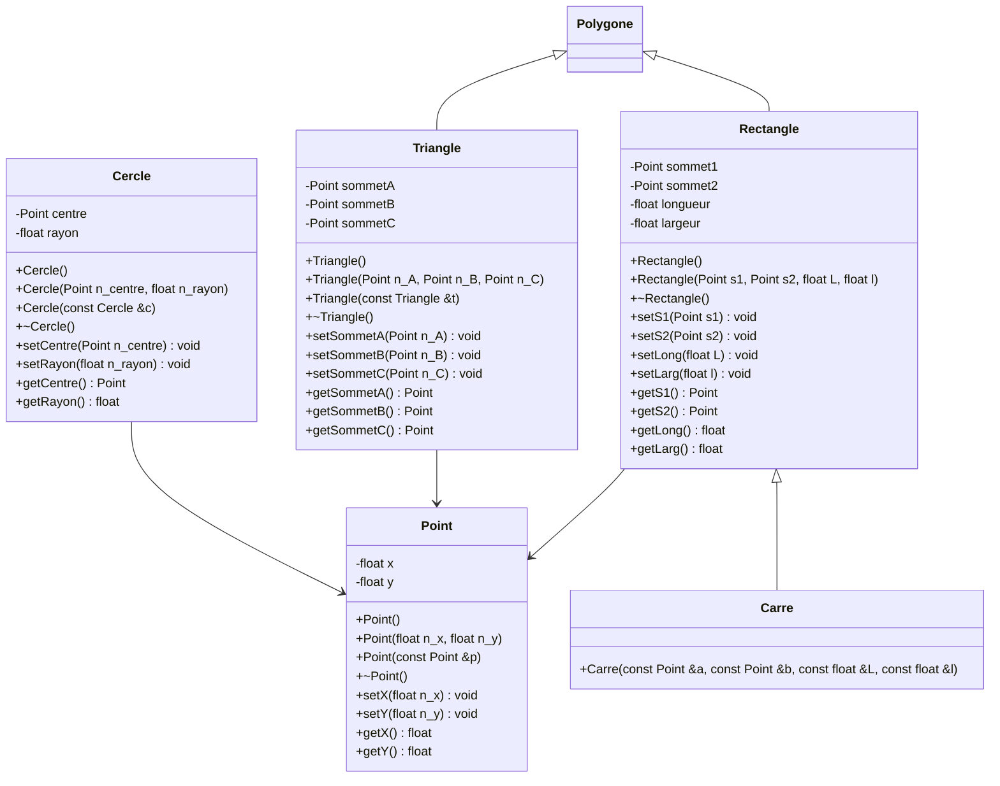

```
 _______  _______  _______  _______ __________________   ______     _______  _______  _______ 
(  ____ )(  ____ )(  ___  )(  ____ \\__   __/\__   __/  / ___  \   (  ____ )(  ___  )(  ___  )
| (    )|| (    )|| (   ) || (    \/   ) (      ) (     \/   \  \  | (    )|| (   ) || (   ) |
| (____)|| (____)|| |   | || (_____    | |      | |        ___) /  | (____)|| |   | || |   | |
|  _____)|     __)| |   | |(_____  )   | |      | |       (___ (   |  _____)| |   | || |   | |
| (      | (\ (   | |   | |      ) |   | |      | |           ) \  | (      | |   | || |   | |
| )      | ) \ \__| (___) |/\____) |___) (___   | |     /\___/  /  | )      | (___) || (___) |
|/       |/   \__/(_______)\_______)\_______/   )_(     \______/   |/       (_______)(_______)

```

