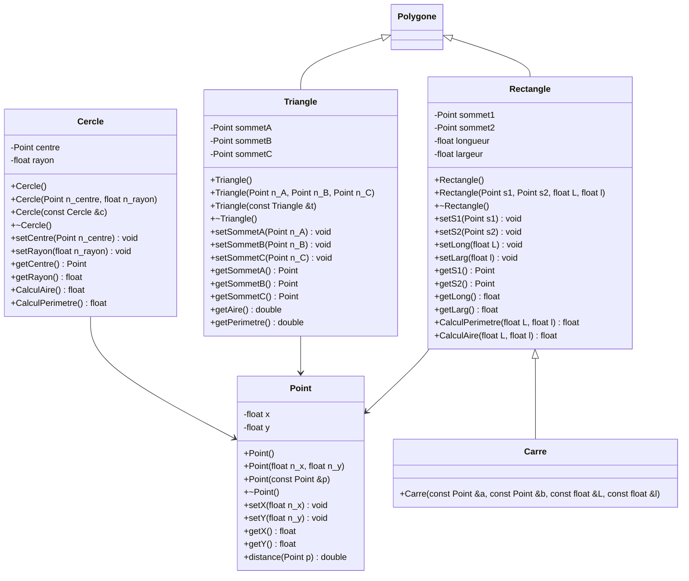
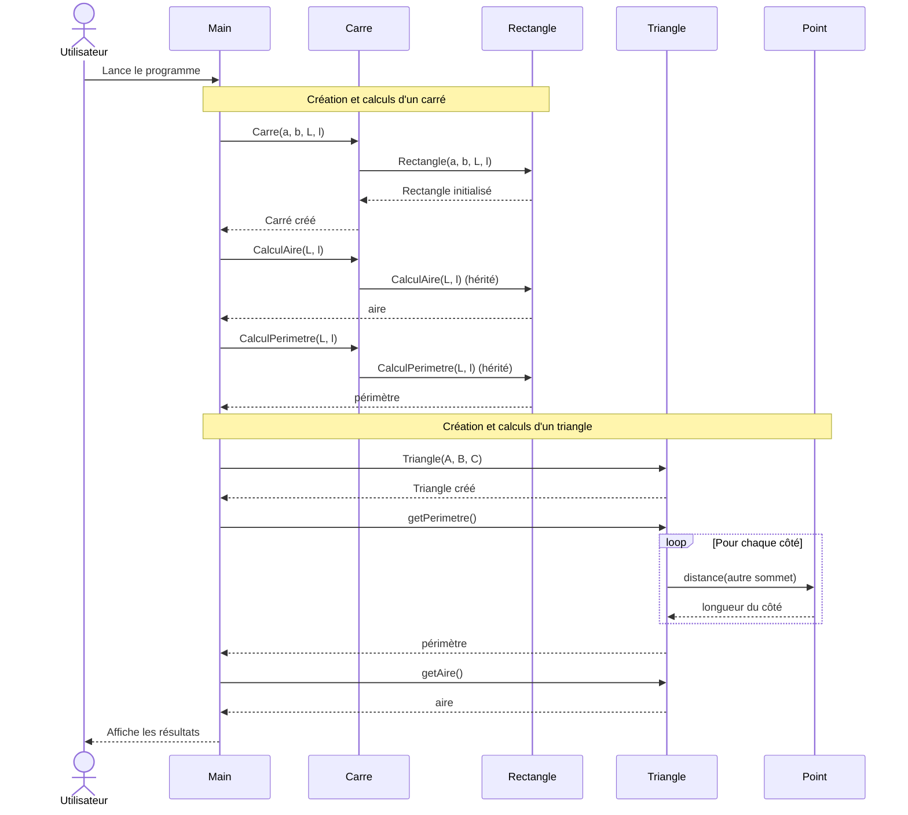

```
 _______  _______  _______  _______ __________________   ______     _______  _______  _______ 
(  ____ )(  ____ )(  ___  )(  ____ \\__   __/\__   __/  / ___  \   (  ____ )(  ___  )(  ___  )
| (    )|| (    )|| (   ) || (    \/   ) (      ) (     \/   \  \  | (    )|| (   ) || (   ) |
| (____)|| (____)|| |   | || (_____    | |      | |        ___) /  | (____)|| |   | || |   | |
|  _____)|     __)| |   | |(_____  )   | |      | |       (___ (   |  _____)| |   | || |   | |
| (      | (\ (   | |   | |      ) |   | |      | |           ) \  | (      | |   | || |   | |
| )      | ) \ \__| (___) |/\____) |___) (___   | |     /\___/  /  | )      | (___) || (___) |
|/       |/   \__/(_______)\_______)\_______/   )_(     \______/   |/       (_______)(_______)

```

# PROSIT 3 - Problème d’héritage 

## Contexte
Jean-Eude a postulé pour un stage chez AutoDesk et son profil intéresse, il doit donc passer un entretien technique dans lequel il lui est demandé de faire une application graphique simple permettant de faire des formes géométriques de base.

## Mots clés
- **concept érigé en graal** : L'héritage (ou la Réutilisabilité), principe fondamental de la POO permettant de réutiliser et d'étendre les comportements et structures de données.
- **arbre d'héritage** : Structure arborescente représentant les relations de parenté (classe mère / classes filles) entre les différentes classes d'objets.
- **attribut** : Variable de donnée propre à une classe ou une forme géométrique (ex: rayon, largeur, longueur, coordonnées).
- **sémantique** : Signification et sens donné aux relations entre les formes (ex: la relation "est-un" entre Carré et Rectangle).
- **hiérarchie des classes** : Organisation structurée des classes de la plus générale (Forme/Polygone) aux plus spécifiques (Carré, Cercle, Triangle).
- **diagramme de classe** : Schéma UML statique décrivant les classes, leurs attributs, méthodes et relations (héritage, association).
- **diagramme de séquences** : Schéma UML dynamique montrant les échanges de messages entre objets au cours du temps.
- **sous-classes** : Classes dérivées (ex: Carré, Triangle) qui héritent des attributs et méthodes d'une classe mère (ex: Forme ou Polygone).
- **vecteur** : Conteneur dynamique (std::vector en C++) ou entité géométrique servant à définir des sommets et translations.
- **polygone auto sécant** : Polygone dont les côtés se croisent entre eux.
- **géométrique** : Relatif aux formes géométriques et à leurs propriétés spatiales (aire, périmètre, coordonnées).

## Problématique
Comment gérer la relation entre polygones, cercles, carrés, rectangles et triangles ?

## Piste de solution

- définir les mots clés

## Plan d’action
- Trouver le lien entre les différents formes géométrique
- Modéliser les différentes classes dans un diagramme UML
- Faire un diagramme de séquences
- Regrouper et faire des héritages avec des sous classes.
- Comprendre comment faire des héritages en C++
- Faire ses classes en C++

## Contrainte
- Pas de partie graphique

## Livrable
- l’application
- les diagrammes

## Généralisation
Apprendre à utiliser l’héritage en C++. Quand plusieurs classes se ressemblent, comme nos formes géométriques, on met ce qu’elles ont en commun dans une classe mère et chaque forme garde seulement ce qui lui est propre. Ça évite de réécrire le même code plusieurs fois, et le programme est plus simple à comprendre et à faire évoluer si on veut ajouter une nouvelle forme plus tard.

## Diagramme de classe



## Diagramme de séquence


